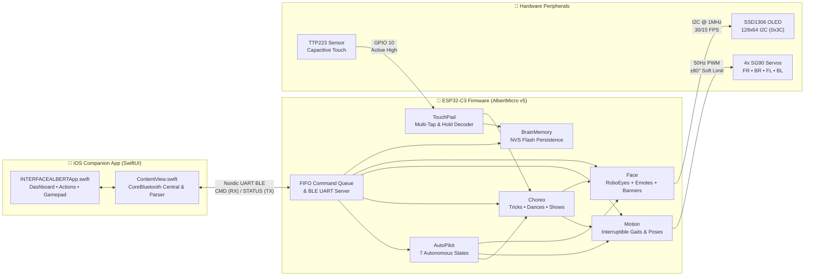
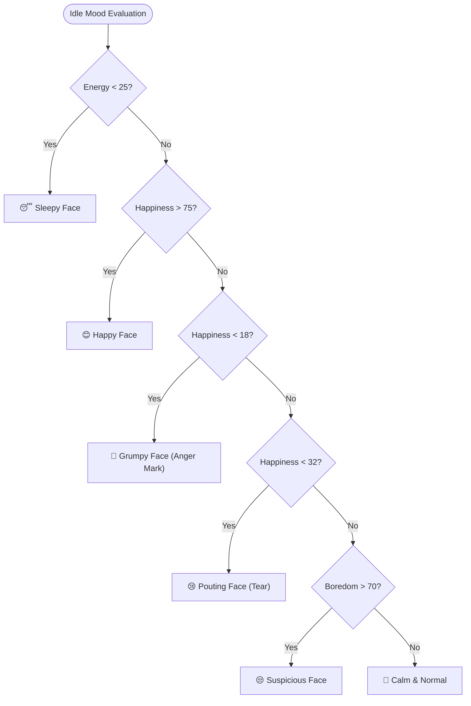

<div align="center">

# 🤖 Albert — Autonomous Quadruped Desk Robot

**A four-legged pocket companion built on ESP32-C3 with persistent NVS memory, procedural OLED expressions, capacitive touch sensing, and a real-time SwiftUI iOS controller over BLE.**

[](#hardware--wiring)
[](#1-flash-the-firmware)
[](#ios-companion-app)
[](docs/ble-protocol.md)
[](#hardware--wiring)
[](#hardware--wiring)

[](https://github.com/gungfebrian/AlbertoDogRobot/commits/main)
[](https://github.com/gungfebrian/AlbertoDogRobot)
[](https://github.com/gungfebrian/AlbertoDogRobot)
[](#repository-structure)
[](docs/ble-protocol.md)

---

[**Overview**](#-overview) •
[**Architecture**](#-system-architecture) •
[**Hardware & Wiring**](#-hardware--wiring) •
[**Getting Started**](#-getting-started) •
[**iOS App**](#-ios-companion-app) •
[**Commands**](#-command-reference) •
[**Personality Engine**](#-autonomous-brain--personality) •
[**Power & Reliability**](#-power--reliability-engineering) •
[**Bonus: S3 Radio**](#-bonus-esp32-s3-internet-radio--synced-lyrics) •
[**Troubleshooting**](#-troubleshooting)

</div>

---

## 📖 Overview

**Albert** is an expressive four-legged desk robot powered by an **ESP32-C3**. He features an animated face on a `128×64` I2C OLED display, a capacitive touch pad on his head, non-volatile flash memory (`NVS`) that survives power cycles, and a dynamic personality that drifts between **happy**, **bored**, **sleepy**, and **properly grumpy** depending on how you treat him.

You can pilot him directly from a custom **SwiftUI iPhone app** over Bluetooth Low Energy, send plain-text commands over Serial/BLE UART, or leave him in **Autopilot Mode** to live his own life on your desk.

### ✨ Key Highlights

| Feature | Description |
| :--- | :--- |
| 🧠 **Persistent NVS Brain** | Tracks **Happiness**, **Energy**, **Boredom**, and **Bonding** across reboots, auto-saving to flash every 30 seconds. |
| 👀 **Procedural OLED Face** | Powered by `RoboEyes` + custom procedural overlays (anger marks, tears, hearts, sweat drops) and full-screen synchronized text banners. |
| 🕺 **60+ Built-in Routines** | Includes 7 continuous gaits, 6 static poses, 22 acrobatic tricks, 14 choreographed dances, 4 synchronized text shows, and 18 facial expressions. |
| 📱 **Native SwiftUI Companion** | Live mirrored facial animation, 3-second telemetry sync, activity lock chips, command library, and a PlayStation-style dual-deck gamepad. |
| 🤖 **Weighted Autonomous Life** | Evaluates internal mood metrics to choose between 7 autonomous activities (`Chill`, `Explore`, `Play`, `Seek`, `Groom`, `Zoomies`, `Show-off`) with 30% stochastic exploration. |
| ⚡ **5-Layer Brown-Out Defense** | Soft mechanical angle limits (`±80°`), staged pairwise servo actuation, brown-out reset detection, 1 MHz I2C frame budgeting, and a FIFO command queue. |

---

## 🏗 System Architecture



### 📂 Repository Structure

```text
AlbertoDogRobot/
├── AlbertMicro_ESP32C3_v5/
│   └── AlbertMicro_ESP32C3_v5.ino   # Main ESP32-C3 robot firmware (OOP architecture)
├── INTERFACEALBERT/
│   ├── ContentView.swift            # iOS App entry point, CoreBluetooth stack & telemetry parser
│   ├── INTERFACEALBERTApp.swift     # SwiftUI views: Live Face, Dashboard, Actions & Controller
│   └── Assets.xcassets/             # App icons and visual assets
├── INTERFACEALBERT.xcodeproj/       # Xcode project configuration
├── docs/
│   └── ble-protocol.md              # Cross-platform BLE UART wire protocol specification
├── esp32s3_radio_lyrics__2_.ino     # Bonus sketch: ESP32-S3 Internet Radio with live LRC OLED lyrics
└── README.md                        # Project documentation
```

| Path | Role & Responsibility |
| :--- | :--- |
| [`AlbertMicro_ESP32C3_v5/AlbertMicro_ESP32C3_v5.ino`](AlbertMicro_ESP32C3_v5/AlbertMicro_ESP32C3_v5.ino) | Complete ESP32-C3 firmware organized into single-responsibility C++ classes (`BrainMemory`, `Face`, `Motion`, `TouchPad`, `Choreo`, `AutoPilot`). |
| [`INTERFACEALBERT/ContentView.swift`](INTERFACEALBERT/ContentView.swift) | SwiftUI `@main` entry point, CoreBluetooth auto-reconnect state machine, and `STATUS` telemetry parser. |
| [`INTERFACEALBERT/INTERFACEALBERTApp.swift`](INTERFACEALBERT/INTERFACEALBERTApp.swift) | Full user interface: procedural mirrored face canvas, dashboard cards, categorized command library, and virtual dual-shock controller. |
| [`INTERFACEALBERT.xcodeproj`](INTERFACEALBERT.xcodeproj) | Xcode project for building and deploying the iOS companion app. |
| [`docs/ble-protocol.md`](docs/ble-protocol.md) | Formal specification for the Nordic UART BLE service, UUIDs, command queuing, and telemetry packet structure. |
| [`esp32s3_radio_lyrics__2_.ino`](esp32s3_radio_lyrics__2_.ino) | Standalone bonus project for **ESP32-S3**: streams internet radio over I2S (`MAX98357A`) and fetches synchronized `.lrc` lyrics from LRCLIB onto an OLED. |

> [!NOTE]
> **Heads-up on Swift filenames:** `ContentView.swift` and `INTERFACEALBERTApp.swift` have historically swapped roles—`INTERFACEALBERTApp.swift` holds the UI views while `ContentView.swift` contains the `@main` app struct and Bluetooth manager. Everything compiles and runs cleanly out of the box; just keep this in mind when navigating the source.

---

## 🔧 Hardware & Wiring

### Bill of Materials (BOM)

| Component | Specification | Purpose |
| :--- | :--- | :--- |
| **Microcontroller** | **ESP32-C3** Dev Board (with USB) | Main processor, BLE 5.0 radio, and NVS flash storage |
| **Display** | **SSD1306** 0.96" OLED (`128×64`, I2C `0x3C`) | Renders animated eyes, emotion overlays, and text banners |
| **Actuators** | **4× SG90** Micro Hobby Servos (`9g`) | Independent 4-leg locomotion and pose actuation |
| **Touch Sensor** | **TTP223** Capacitive Touch Module | Head-mounted touch sensor (`Active High`) for taps and petting |
| **Power Supply** | **5V High-Current Rail / LiPo + Buck** | Must sustain 4 servos stalling simultaneously without voltage sag |

### GPIO Pinout Map

```text
                    ┌─────────────────────────┐
                    │      ESP32-C3 MCU       │
                    │                         │
   [SSD1306 SDA] ◄──┤ GPIO 6          GPIO 0  ├──► Front-Right Servo (FR)
   [SSD1306 SCL] ◄──┤ GPIO 4          GPIO 1  ├──► Back-Right Servo  (BR)
                    │                 GPIO 2  ├──► Front-Left Servo  (FL)
   [TTP223 OUT]  ──►│ GPIO 10         GPIO 3  ├──► Back-Left Servo   (BL)
                    └─────────────────────────┘
```

| Peripheral Signal | ESP32-C3 Pin | Direction | Notes |
| :--- | :---: | :---: | :--- |
| **OLED SDA** | `GPIO 6` | Bidirectional | I2C Data (`Wire.setClock(1000000)` @ 1 MHz) |
| **OLED SCL** | `GPIO 4` | Output | I2C Clock (Address `0x3C`) |
| **Front-Right Servo (`FR`)** | `GPIO 0` | Output (PWM) | Right-side forward horn orientation |
| **Back-Right Servo (`BR`)** | `GPIO 1` | Output (PWM) | Right-side backward horn orientation |
| **Front-Left Servo (`FL`)** | `GPIO 2` | Output (PWM) | Mirrored left-side forward orientation |
| **Back-Left Servo (`BL`)** | `GPIO 3` | Output (PWM) | Mirrored left-side backward orientation |
| **Touch Sensor (`TTP223`)** | `GPIO 10` | Input | Active-high digital touch input |

> [!IMPORTANT]
> **Two mechanical rules that will save you an afternoon of debugging:**
>
> 1. **Left and right servos are physically mirrored:** The `FR` horn faces forward, the `BR` horn faces backward, and the left side mirrors the right. Because of this symmetry, left and right legs never receive the same raw angle for the same motion—the firmware drives left legs with `CENTER - x` whenever right legs receive `CENTER + x`. If a leg curls the wrong way, **check your `SERVO_PINS` wiring order first, not the kinematics math.**
> 2. **Poses never press against the mechanical hard stop:** Fully stretched poses stop at **`±80°`** from center (`STRETCH`), never `±90°`. Driving an SG90 into its physical end-stop causes a stall current spike that drops the power rail and triggers an ESP32 brown-out reset.

---

## 🚀 Getting Started

### 1. Flash the Firmware

Install the required libraries in the Arduino IDE Library Manager or via `arduino-cli`:

| Library | Author | Purpose |
| :--- | :--- | :--- |
| `ESP32Servo` | Kevin Harrington / John K. Bennett | Hardware PWM generation for the 4 leg servos |
| `Adafruit GFX Library` | Adafruit | Core graphics primitives and font rendering |
| `Adafruit SSD1306` | Adafruit | I2C driver for the `128×64` monochrome OLED |
| `FluxGarage RoboEyes` | Dennis Hoelscher (FluxGarage) | Procedural animated robot eyes engine |

Compile and upload using **`arduino-cli`** (or open `AlbertMicro_ESP32C3_v5/AlbertMicro_ESP32C3_v5.ino` in the Arduino IDE, select **ESP32C3 Dev Module**, and click **Upload**):

```bash
# Compile the sketch for ESP32-C3
arduino-cli compile --fqbn esp32:esp32:esp32c3 AlbertMicro_ESP32C3_v5

# Upload to the connected board
arduino-cli upload --fqbn esp32:esp32:esp32c3 -p /dev/cu.usbmodemXXXX AlbertMicro_ESP32C3_v5
```

### 2. Build & Connect the iOS App

1. Open `INTERFACEALBERT.xcodeproj` in **Xcode**.
2. Select your physical iPhone as the run destination (CoreBluetooth requires a real device) and press **Run (`⌘R`)**.
3. Accept the **Bluetooth permission prompt** on first launch.
4. Tap **Scan & Connect**—Albert advertises as **`AlbertMini`** and connects within 1–2 seconds.

---

## 📱 iOS Companion App

The iOS app features three dedicated tabs at the bottom of the screen. If the Bluetooth connection drops (e.g., Albert reboots or walks out of range), the app automatically clears stale handles, rescans, and reconnects in the background.

> 📄 **Developers:** For the complete cross-platform BLE UUID and wire contract specification, see [**`docs/ble-protocol.md`**](docs/ble-protocol.md).

### 1️⃣ Albert Tab — Live Dashboard

The primary "living with Albert" screen. The hero card renders **Albert's face live on your phone**, mirrored from his 3-second telemetry feed:
- Blinks, breathes, glances around, and transitions expressions automatically.
- Displays the pulsing anger mark (`💢`) in the top-left corner when grumpy, matching the physical OLED.
- **Interactive Petting:** Tap directly on the face card to pet him (`PET`).
- **Live Status Header:** Displays current mood, active routine (e.g., `Happy · ZOOMIES!`), and the last message sent by Albert over BLE.

| Dashboard Section | Capabilities |
| :--- | :--- |
| **Mood Telemetry Bars** | Real-time progress bars for **Happiness**, **Energy**, and **Bonding**, plus counters for **Lifetime Pets**, **Age**, and last BLE status message. |
| **Autopilot Selector** | Toggle **Free Roam** (`AUTO`) or lock Albert into one of 7 specific autonomous behaviors (**Chill**, **Explore**, **Play**, **Cuddle**, **Groom**, **Zoomies**, **Show off**) with live active-chip highlighting. |
| **Stage Shows** | One-tap triggers for the 4 headline performances (`INTRO`, `5G GACOR`, `TEAM`, `PARTY`)—banner text flashes on the app's face canvas in sync with the robot's OLED. |
| **Quick Move D-Pad** | Directional pad for walking forward/backward, turning left/right, spinning in place, and stopping. |

### 2️⃣ Actions Tab — Command Library

A comprehensive command catalog organized via a color-coded segmented picker:
- **Categories:** `Poses` • `Tricks` • `Dances` • `Feelings` • `System`
- **Mini Live Face:** A compact live face header sits at the top of the page so tapping `Feelings` buttons gives immediate visual feedback.
- **System Controls:** Trigger `AUTO`, `SLEEP`, `STATS` (draws stats on OLED), `SAVE` (manual NVS commit), `RESET` (includes a confirmation dialog before wiping memory), and `Disconnect`.

### 3️⃣ Control Tab — PlayStation-Style Gamepad

Transforms your iPhone into a tactile horizontal-style game controller for manual piloting.

| Control Element | Behavior & Engineering |
| :--- | :--- |
| **Left Analog Stick** | Drag in any direction: **Up** = Walk (`WALK`), **Down** = Reverse (`BACK`), **Left/Right** = Turn (`LEFT`/`RIGHT`). Releasing snaps to center and sends `STOP`. Includes a center dead zone and **zone-transition throttling** so BLE packets are only transmitted when crossing into a new direction zone. |
| **Right Emotion Diamond** | Four action buttons arranged in a classic PlayStation diamond layout (`△ ○ × □` positions). Each press fires an instant facial expression. |
| **Emotion Bank Switcher** | Segmented control below the deck that swaps the Emotion Diamond between three themed preset banks (`Sunny`, `Grumpy`, `Drama`). |
| **Shoulder Triggers (`SPIN L` / `SPIN R`)** | Hold to spin continuously left or right in place; release to send `STOP`. |
| **Utility Bar (`STAND` / `SIT` / `STOP`)** | Quick-recovery posture buttons along the bottom edge. |

#### Emotion Diamond Banks

| Bank | 🔼 Top | ▶️ Right | 🔽 Bottom | ◀️ Left |
| :--- | :---: | :---: | :---: | :---: |
| ☀️ **Sunny** | `HAPPY` | `LOVE` | `CUTE` | `LAUGH` |
| 💢 **Grumpy** | `GRUMPY` | `ANGRY` | `FURIOUS` | `POUT` |
| 🎭 **Drama** | `SURPRISED` | `SAD` | `SLEEPY` | `SUS` |

---

## 📡 Command Reference

Every action supported by Albert is exposed via case-insensitive UTF-8 plain-text commands over **USB Serial (`115200` baud)** or **BLE UART** (Service `6E400001-B5A3-F393-E0A9-E50E24DCCA9E`).

### 🐾 Movement & Locomotion

| Command | Action |
| :--- | :--- |
| `WALK` | Walk forward continuously |
| `BACK` | Walk backward continuously *(true reverse: runs the gait phase wave backward in time)* |
| `LEFT` / `RIGHT` | Turn left or right while walking |
| `SL` / `SR` | Spin counter-clockwise (`SL`) or clockwise (`SR`) in place |
| `STOP` | Abort active motion and return to neutral standing posture |

### 🧘 Static Poses

| Command | Action |
| :--- | :--- |
| `UP` | Stand tall at neutral center calibration |
| `SIT` | Sit back on hind legs |
| `LIE` | Lie down with a moderate leg stretch |
| `LAYDOWN` | Full flat sprawl—front legs swept forward, back legs swept back *(staged pair-by-pair to prevent current spikes)* |
| `REST` | Relaxed sploot posture |
| `SLEEP` | Enter nap mode—regenerates **Energy** over time |

### 🎪 Tricks & Acrobatics (22 Routines)

```text
PUSHUPS   SWING     GALLOP    BOUNCE    STRETCH   WAVE      SHAKE     WIGGLE
BOW       BEG       SPINPOSE  YES       NO        SAD       SCARED    PLAYDEAD
SNEEZE    KISS      ZOOMIES   TANTRUM   SULK      SHY
```

#### Crowd-Favourite Highlights

| Command | Choreography Breakdown |
| :--- | :--- |
| `GALLOP` | Glances left and right, then executes three escalating rounds of bounds that grow faster and wider, finishing with a spring-loaded leap. |
| `PLAYDEAD` | Wobbles dramatically, flops completely flat onto the floor, lies motionless, then pops back up delighted with himself. |
| `TANTRUM` | Furious rapid stomping followed by throwing himself flat on the ground in a huff. |
| `SULK` | Turns his back on you and side-eyes over his shoulder until you feel guilty. |
| `ZOOMIES` | High-speed chaotic energy burst: sprints, spins, sprints again, and finishes dazed and confused. |

### 🪩 Dances (14 Routines)

```text
DANCE     MOONWALK  CHACHA    HEADBANG  STOMP     SALUTE    PEEKABOO
POUNCE    TWIST     BREAKDANCE ROBOT    DISCO     BALLET    PARTY
```

> 🎉 **`PARTY` Medley:** Announces each dance by name on the OLED screen, performs all of them back-to-back, and finishes with a flashing **`YEAY`** celebration banner.

### 📺 Synchronized Text Shows

During text performances, the eye renderer enters a dedicated blanked text state so full-screen typography never collides with facial graphics. Once the show completes, the eyes seamlessly return.

| Command | Performance Sequence |
| :--- | :--- |
| `INTRO` | Flashes **`HI!` → `I'M` → `ALBERTO`** on the OLED, performs a synchronized bow, and finishes with a wave. |
| `GACOR` | Dramatic eye intro, a 360° spin, then **`5G` / `GACOR!`** flashing across the screen while bouncing to the beat. |
| `TEAM` | Roll-call performance flashing **`GUNG` • `MAYUN` • `GABBY` • `ABUI` • `TIO`** three times with a cha-cha step for each name. |
| `DEMO` | Guided showcase tour cycling through every facial expression in the firmware. |

### 😊 Facial Expressions (18 Moods)

```text
HAPPY     ANGRY     GRUMPY    FURIOUS   POUT      TIRED     SLEEPY    SURPRISED   SUS
CUTE      LOVE      NERVOUS   CYCLOPS   LAUGH     CONFUSED  SCAN      WINK        FACE
```

- **`GRUMPY`**: Half-lidded sideways glare with a comic anger mark (`💢`) in the top-left corner of the OLED.
- **`FURIOUS`**: Full escalation—wide glaring eyes with throbbing anger marks in both upper corners.

### 👁 Gaze & System Control

| Command | Action |
| :--- | :--- |
| `LOOKUP` / `LOOKDOWN` / `LOOKLEFT` / `LOOKRIGHT` | Point the OLED eyes toward a specific direction |
| `AUTO` | Enable autonomous **Free Roam** mode |
| `AUTO CHILL` / `EXPLORE` / `PLAY` / `SEEK` / `GROOM` / `ZOOM` / `SHOW` | Lock autonomous mode into a single activity category |
| `PET` | Trigger a virtual pet interaction (identical to holding the head touch sensor) |
| `STATUS` | Emit a single-line telemetry report (`H`, `E`, `B`, `Bond`, `pets`, `age`, `act`) **inline without interrupting motion** |
| `STATS` | Render the full brain statistics summary directly onto the physical OLED |
| `SAVE` | Immediately commit current mood and bonding metrics to NVS flash |
| `RESET` | Wipe NVS flash memory back to factory defaults (`happiness`, `bonding`, `pets`, `age`) |

> [!TIP]
> **Why `STATUS` never stutters the robot:** The iOS app polls `STATUS` every 3 seconds. Unlike movement or trick commands—which immediately preempt the current action for snappy responsiveness—`STATUS` is intercepted and answered inline without clearing or interrupting the active choreography.

---

## 🧠 Autonomous Brain & Personality

Albert's personality is driven by four persistent state variables stored in ESP32 Non-Volatile Storage (`NVS`) and committed every 30 seconds:

| Metric | Increases When (▲) | Decreases When (▼) |
| :--- | :--- | :--- |
| **Happiness** (`0–100`) | Petting, performing tricks, receiving attention | Poking when annoyed, prolonged boredom, neglect |
| **Energy** (`0–100`) | Sleeping (`SLEEP` or 3-tap nap) | Active movement, tricks, and especially dancing |
| **Boredom** (`0–100`) | Time passing with zero user interaction | Any touch gesture or BLE command |
| **Bonding** (`0–100`) | Petting (especially sustained head holds) | **Never** — Albert never forgets his bond with you |

### Resting Expression Priority Ladder

When idle, Albert continuously evaluates his internal metrics from top to bottom to choose his resting face:



> [!WARNING]
> **Poke Escalation:** Poking Albert repeatedly when he is already unhappy escalates his reaction: first an annoyed head-shake (`NO`), then turning his back to sulk (`SULK`), and if **Happiness drops below 18**, a full-blown **`TANTRUM`**. You have been warned.

### Autopilot Behavioral Engine

In `AUTO` mode, Albert selects an activity state, commits to it for **8 to 30 seconds**, and then re-evaluates. Selection is **70% weighted by current mood metrics** and **30% purely random**, ensuring he feels organic rather than trapped in a deterministic state loop. Between major routines, he performs **micro-idles** (subtle weight shifts, eye glances, slow blinks, and brief mood flashes) so he never freezes like a statue.

| Autonomous Activity | Lock Command | Behavioral Flavour |
| :--- | :---: | :--- |
| **Chill** | `AUTO CHILL` | Scans the room, slow blinks, occasional sneeze or shy moment |
| **Explore** | `AUTO EXPLORE` | Wanders forward/left/right and inspects his surroundings |
| **Play** | `AUTO PLAY` | Picks from 16 playful routines—from a quick twist to a full breakdance |
| **Seek Attention** | `AUTO SEEK` | Walks up to you, waves, begs, blows a kiss, or guilt-trips you with a sulk |
| **Groom** | `AUTO GROOM` | Stretches out his legs and shakes off |
| **Zoomies** | `AUTO ZOOM` | Sudden high-energy bursts, sprints, and gallops |
| **Show-off** | `AUTO SHOW` | Full stage routines: disco, ballet, robot dance, pushups, and a bow |

### Capacitive Touch Gestures (`TTP223`)

| Head Touch Gesture | Albert's Reaction |
| :--- | :--- |
| **1× Single Tap** | Perks up immediately and pays attention *(unless annoyed—see poke escalation)* |
| **2× Double Tap** | Performs a random trick chosen from a pool of 13 routines |
| **3× Triple Tap** | Goes to sleep (`SLEEP`) to recharge energy |
| **Short Hold (~1s)** | **Petting:** displays floating hearts, boosts **Happiness** and **Bonding** |
| **Long Hold (>2s)** | Launches into a full joyful happy dance |

---

## ⚡ Power & Reliability Engineering

Driving four SG90 servos simultaneously from a compact battery rail is the #1 cause of microcontroller brown-out resets in small quadrupeds. Albert's firmware defends against voltage sag in **five layers**:

| Defense Layer | Technical Implementation |
| :--- | :--- |
| **1. Soft Stretch Limit** | Extreme poses cap servo travel at **`±80°`** from center (`STRETCH`), staying clear of the `±90°` mechanical end-stop where stall current spikes occur. |
| **2. Staged Pairwise Moves** | High-torque transitions like `LAYDOWN` actuate the front pair of legs first, settle briefly, and then actuate the rear pair. |
| **3. Brown-Out Safe Mode** | On boot, the firmware inspects `esp_reset_reason()`. If the previous reset was `ESP_RST_BROWNOUT`, Albert boots into **Safe Mode**: minimal servo settle, nervous face, `AUTO` disabled, and broadcasts `brownout: safe mode` over BLE until woken by a user command. |
| **4. I2C & Frame Budgeting** | The I2C bus runs at **1 MHz** (`400 kHz+ fast mode plus`) and OLED frame pushes are throttled to **30 FPS** (**15 FPS** when procedural emote overlays are active) so display transfers never starve the 50 Hz servo update loop. |
| **5. Non-Blocking FIFO Queue** | Incoming BLE UART commands are pushed into a ring buffer (`FIFO`), ensuring rapid button presses or simultaneous `STATUS` polls never drop or overwrite commands. |

---

## 📻 Bonus: ESP32-S3 Internet Radio & Synced Lyrics

This repository also includes [`esp32s3_radio_lyrics__2_.ino`](esp32s3_radio_lyrics__2_.ino)—a standalone companion sketch for an **ESP32-S3 Mini** that streams live internet radio over I2S and automatically fetches time-synced `.lrc` lyrics onto an OLED screen while gently swaying a decorative servo to the music.

<details>
<summary><strong>🔌 Click to expand ESP32-S3 Radio Wiring, Libraries & Serial Controls</strong></summary>

### Hardware Pinout (ESP32-S3)

| Peripheral | Signal | ESP32-S3 GPIO |
| :--- | :--- | :---: |
| **MAX98357A I2S Amplifier** | `BCLK` / `LRC` / `DIN (DOUT)` | `GPIO 5` / `GPIO 6` / `GPIO 7` |
| **SSD1306 OLED (`128×64`)** | `SDA` / `SCL` | `GPIO 3` / `GPIO 4` |
| **Decorative Servo** | `PWM Signal` | `GPIO 2` |

### Required Libraries & Board Setup

1. Install **`ESP32-audioI2S`** (by *schreibfaul1*), **`Adafruit SSD1306`**, **`Adafruit GFX`**, **`ESP32Servo`**, and **`ArduinoJson`** (v7.x).
2. Select **ESP32S3 Dev Module** in the Arduino IDE and **enable PSRAM** (`Tools -> PSRAM -> OPI/QSPI PSRAM`) for smooth audio buffering and HTTPS lyrics fetching from [LRCLIB](https://lrclib.net).

### Serial Monitor Controls (`115200` baud)

| Key | Action |
| :---: | :--- |
| `n` / `p` | Next / Previous radio station |
| `0` – `9` | Jump directly to station preset `0–9` |
| `+` / `-` | Volume Up / Down |
| `]` / `[` | Shift lyric sync offset by `+250 ms` / `-250 ms` |

</details>

---

## 🛠 Troubleshooting

| Symptom | Root Cause & Resolution |
| :--- | :--- |
| **A leg moves backward or curls inward** | **Pin mapping order.** The expected pin order is `FR=0`, `BR=1`, `FL=2`, `BL=3`. Verify `SERVO_PINS` in the sketch before adjusting pose offsets. |
| **Robot resets mid-pose or during `LAYDOWN`** | **Power supply voltage sag.** Your 5V source cannot handle simultaneous servo stall current. Use a higher-discharge battery/BEC and verify custom poses use `STRETCH` (`±80°`), never raw `±90°`. |
| **Text shows (`INTRO`, `GACOR`, `TEAM`) play on the app but not on the OLED** | **Outdated firmware on the ESP32-C3.** Re-flash the latest `AlbertMicro_ESP32C3_v5.ino` which includes the FIFO command queue and continuous banner repainting. |
| **Controls feel sluggish or unresponsive** | **Outdated firmware.** Re-flash to get the 1 MHz I2C bus, 30 FPS display throttle, and inline `STATUS` handling. |
| **`BACK` makes him walk forward** | **Outdated firmware.** Reverse locomotion was rebuilt to run the gait phase wave backward in time. |
| **He is grumpy all the time (`💢`)** | **That one is on you.** Tap his head or press `PET` in the app—neglect and poking drop his happiness below 18. |

---

## 🏷 A Note on the Name

He introduces himself as **ALBERTO**, performs a roll call for **GUNG**, **MAYUN**, **GABBY**, **ABUI**, and **TIO**, and firmly believes **5G is GACOR!**. None of this is configurable without editing the sketch—which is exactly how it should be.

---

<div align="center">

Built with ❤️ using **ESP32-C3**, **Arduino**, and **SwiftUI** by [@gungfebrian](https://github.com/gungfebrian)

</div>
