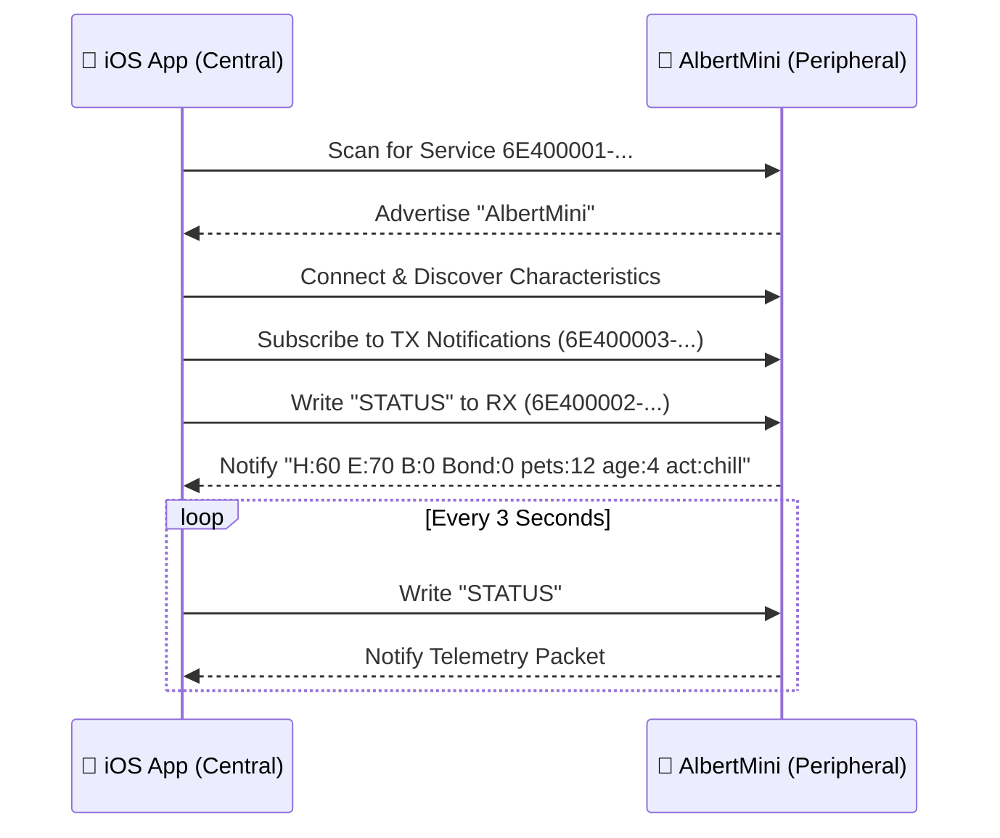

<div align="center">

# 📡 Albert BLE Wire Protocol Specification

[](../README.md)
[](../README.md)
[](../README.md)

</div>

This document defines the compact wire contract between the **ESP32-C3 firmware** ([`AlbertMicro_ESP32C3_v5.ino`](../AlbertMicro_ESP32C3_v5/AlbertMicro_ESP32C3_v5.ino)) and the **iOS SwiftUI controller** ([`ContentView.swift`](../INTERFACEALBERT/ContentView.swift)). Keep the advertised peripheral name, GATT UUIDs, and telemetry wire format stable when modifying either side.

---

## 🔍 GATT Discovery & Characteristics

The robot advertises as **`AlbertMini`** and exposes a standard **Nordic UART Service (NUS)**:

| GATT Role | UUID | Properties | Direction |
| :--- | :--- | :---: | :--- |
| **Primary Service** | `6E400001-B5A3-F393-E0A9-E50E24DCCA9E` | — | Service Discovery |
| **RX Characteristic** | `6E400002-B5A3-F393-E0A9-E50E24DCCA9E` | `Write` / `Write Without Response` | 📱 Phone ➔ 🤖 Robot |
| **TX Characteristic** | `6E400003-B5A3-F393-E0A9-E50E24DCCA9E` | `Notify` | 🤖 Robot ➔ 📱 Phone |

### Connection Sequence



1. Scan for the primary service UUID (`6E400001-B5A3-F393-E0A9-E50E24DCCA9E`) or advertised name (`AlbertMini`).
2. Discover both `RX` and `TX` characteristics.
3. Subscribe to **`TX` notifications** before writing the first command.
4. Commands are **plain UTF-8 text** and **case-insensitive**.

---

## ⚡ Commands & Reply Semantics

Send one command per write transaction without blocking on a reply. Full movement, pose, trick, dance, facial expression, gaze, and autopilot commands are documented in the [main `README.md`](../README.md#-command-reference).

### Core System Commands

| Command | Firmware Execution Behavior | TX Notification |
| :--- | :--- | :--- |
| `STATUS` | Returns the current telemetry line inline **without interrupting** an active motion or show sequence. | `H:<int> E:<int> B:<int> Bond:<int> pets:<int> age:<int> act:<str>` |
| `PET` | Applies the same happiness/bonding boost and heart animation as holding the physical head touch pad. | Status / emote message |
| `AUTO` | Returns control to the robot's autonomous behavior engine (or `AUTO <MODE>` to lock an activity). | Activity status |
| `SAVE` | Immediately persists the robot's brain state to NVS flash. | `saved` |
| `RESET` | Wipes stored NVS flash memory back to defaults. | `memory wiped` |
| `STATS` | Renders the brain state summary screen directly on the physical OLED. | — |

> [!NOTE]
> **FIFO Command Queueing:** Incoming BLE writes are buffered in a non-blocking FIFO queue on the ESP32-C3. Because `STATUS` is handled inline, periodic 3-second telemetry polls never overwrite a user button press, while standard action commands cleanly preempt any active movement or show.

---

## 📊 Telemetry Packet Format

When polled with `STATUS`, the firmware notifies a single space-delimited line on the `TX` characteristic:

```text
H:60 E:70 B:0 Bond:0 pets:12 age:4 act:zoomies!
```

| Key | Metric | Range / Type | Description |
| :---: | :--- | :---: | :--- |
| `H` | **Happiness** | `0–100` (`Int`) | Current mood level (drives resting facial expression) |
| `E` | **Energy** | `0–100` (`Int`) | Stamina level (`< 25` triggers sleepy face; recovers during `SLEEP`) |
| `B` | **Boredom** | `0–100` (`Int`) | Increases with inactivity (`> 70` triggers suspicious face) |
| `Bond` | **Bonding** | `0–100` (`Int`) | Permanent affection metric (never decays) |
| `pets` | **Lifetime Pets** | `0+` (`UInt`) | Cumulative pet interactions persisted in NVS |
| `age` | **Age** | `0+` (`UInt`) | Cumulative uptime/age counter persisted in NVS |
| `act` | **Current Activity** | `String` | Free-form display string describing the active routine (may contain spaces or punctuation) |

> [!IMPORTANT]
> **Parser Implementation Rule:** Because the `act:` value may contain spaces or punctuation (e.g., `act:zoomies!`), clients must parse the first six `key:value` tokens by whitespace and treat the **entire remaining substring after `act:`** as the activity display label.

---

## 🔄 Reconnection & Fault Recovery

- **Client Reconnection:** Upon disconnection, the iOS app clears its cached `CBCharacteristic` references, automatically restarts scanning when CoreBluetooth reports `.poweredOn`, and issues an immediate `STATUS` request upon reconnecting.
- **Brown-Out Notification:** If the ESP32-C3 recovers from a power-rail brown-out reset, it transmits `brownout: safe mode` over `TX` and waits in a low-current state until woken by an explicit command.
